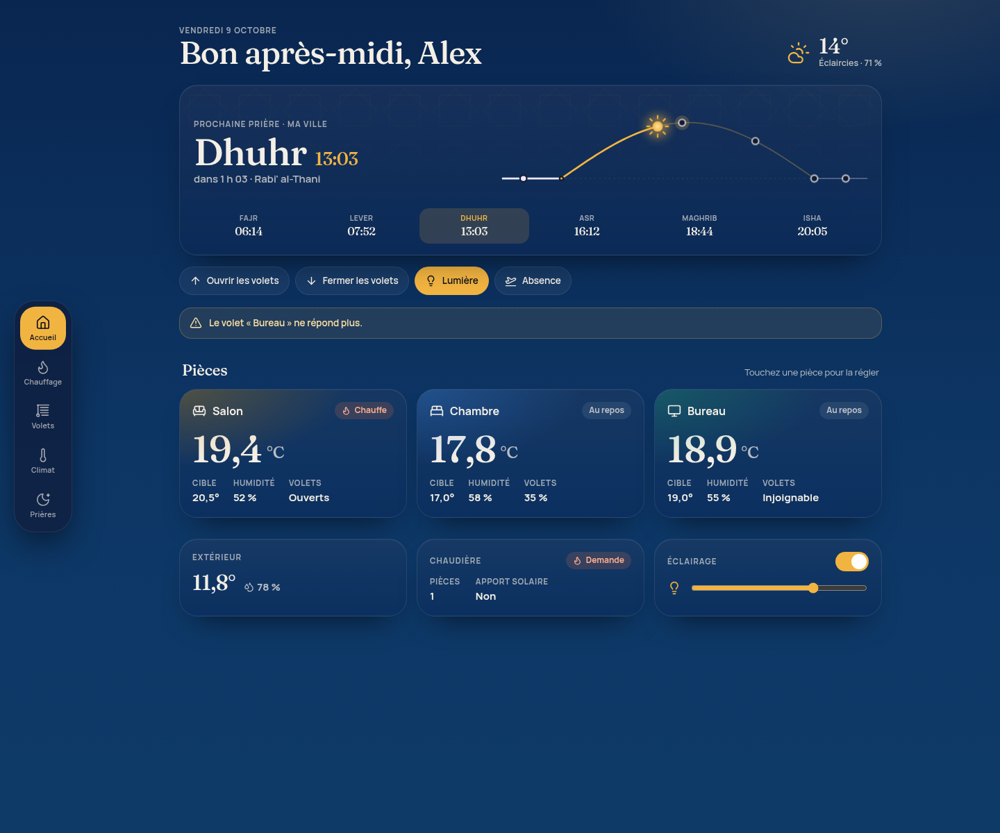
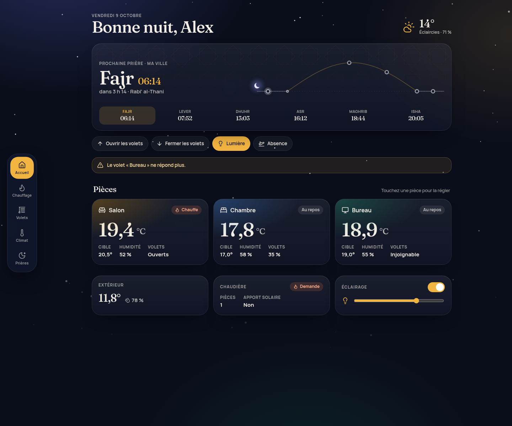
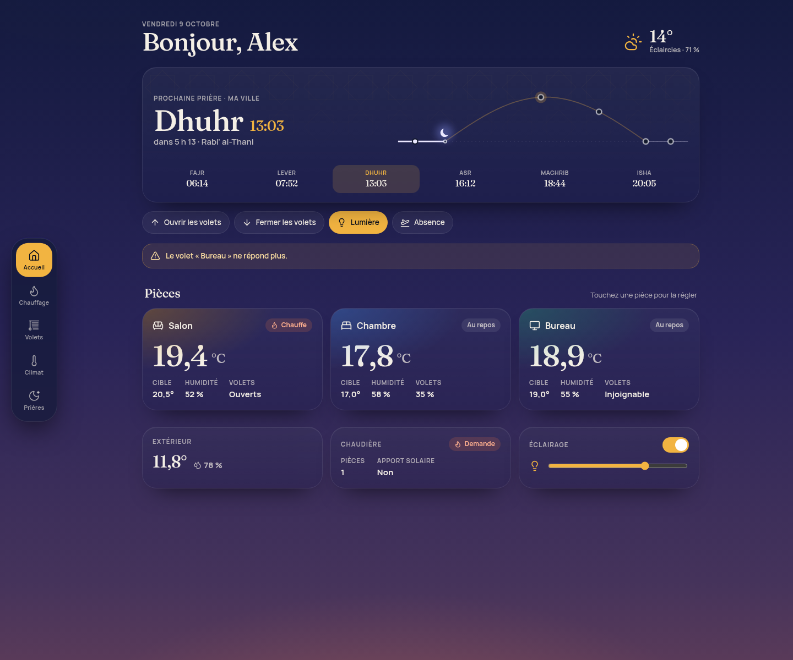
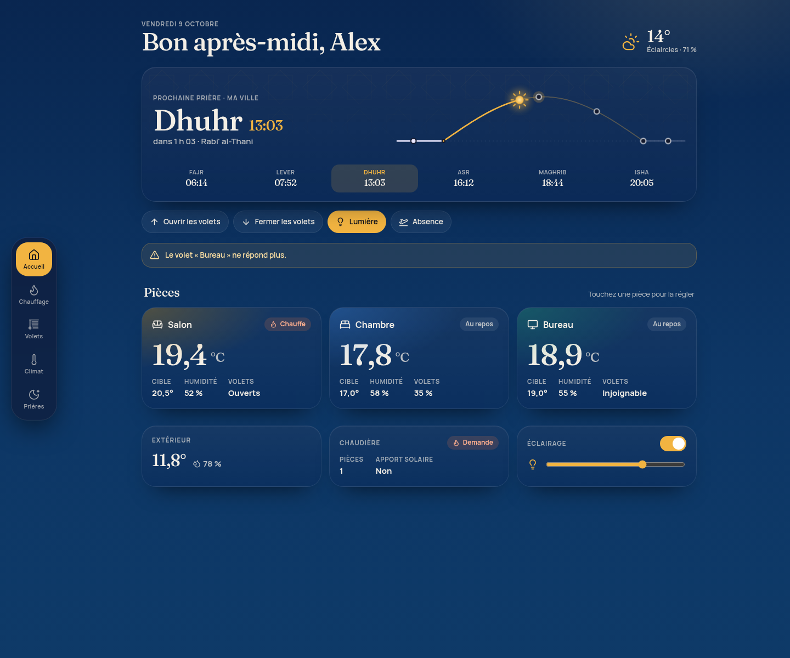
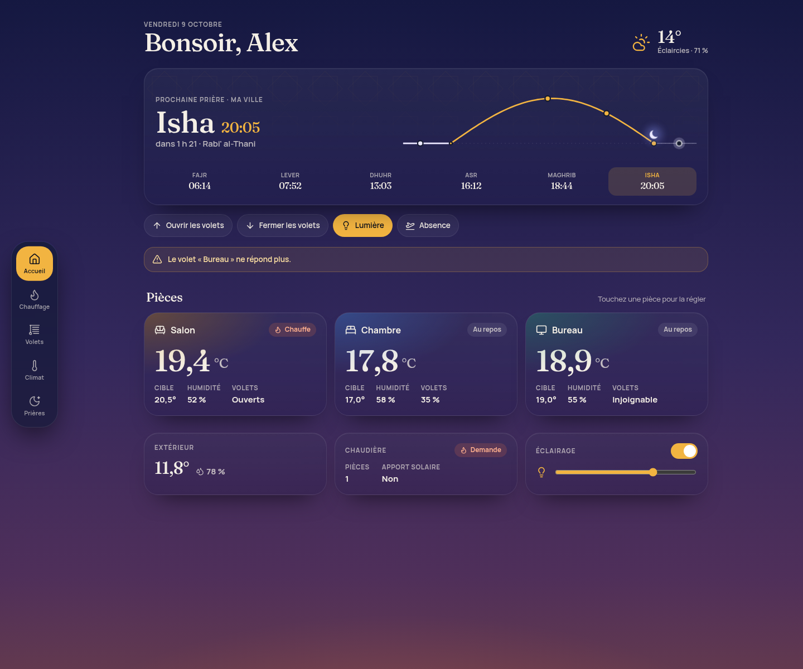
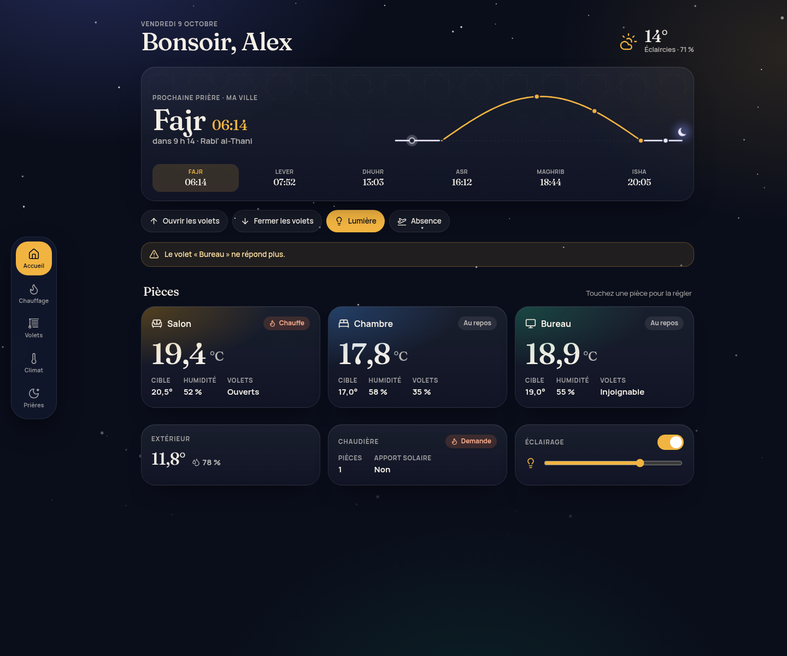
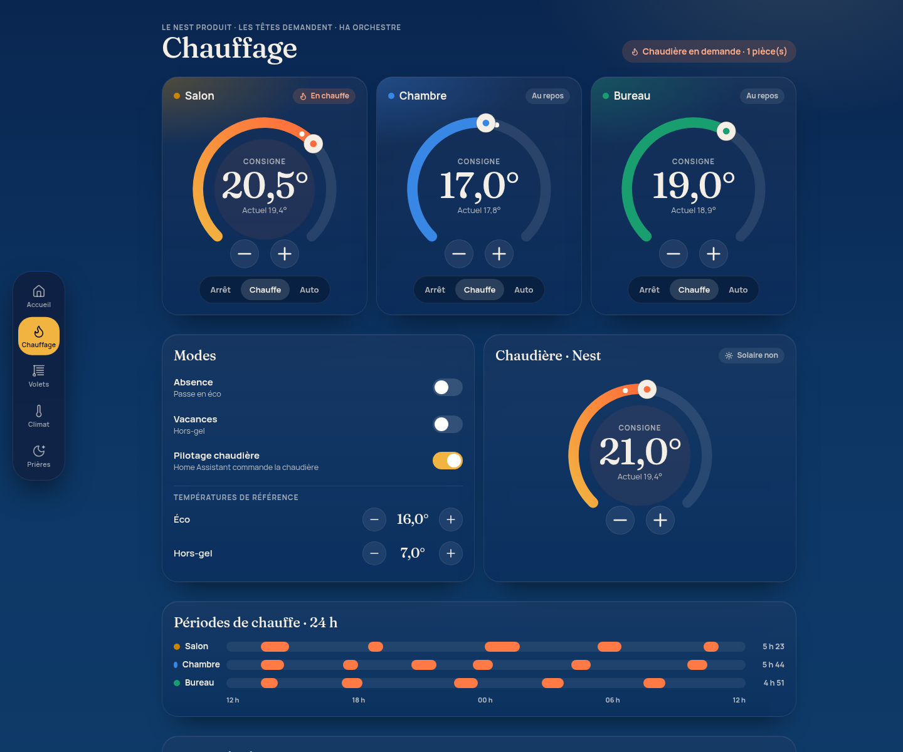
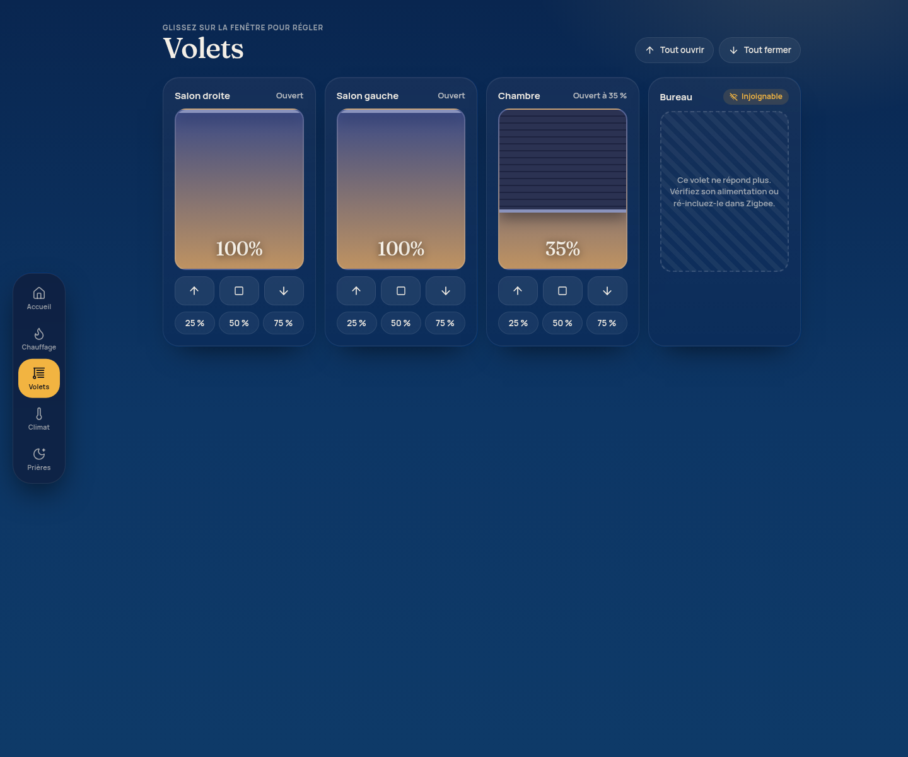
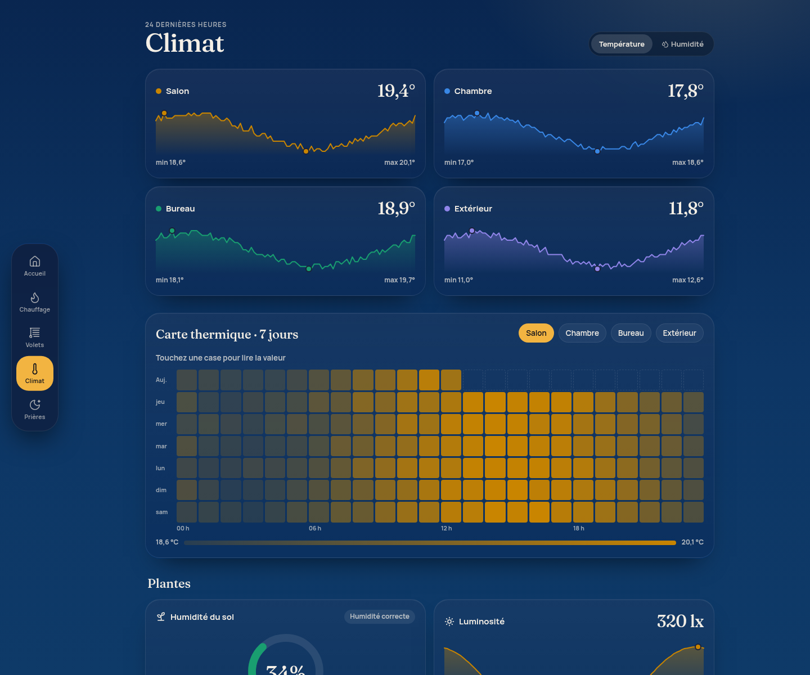
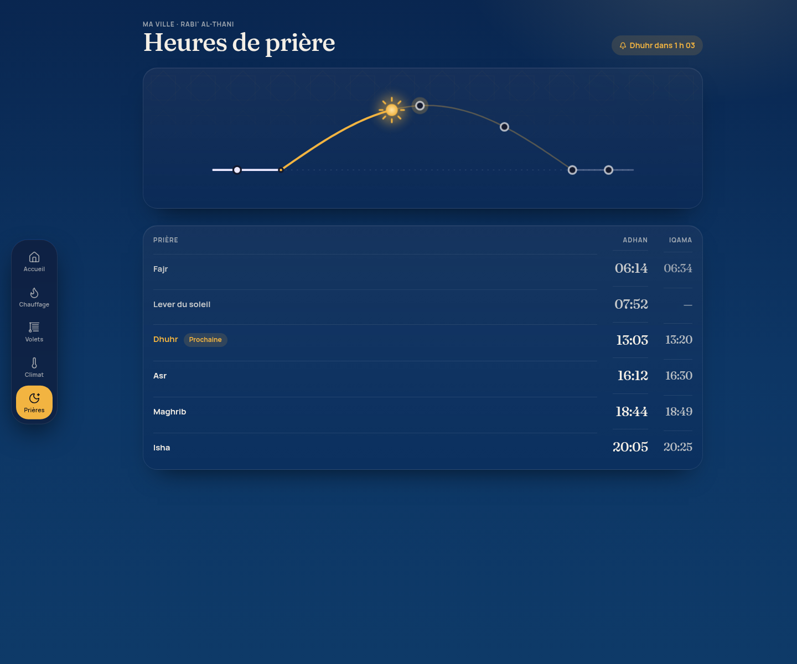

# ha-dash — a dashboard for Home Assistant

A single-page React dashboard for Home Assistant: a home page with a dynamic sky
that follows the real sun and prayer times, a sun arc, per-room cards, heating
with dials, shutters, climate charts and an optional prayer-times page.

The interface is in French and the design system is deliberately dark — deep
night blue, warm brass accents, Fraunces and Manrope bundled locally (no CDN, no
network font).



## The sky follows your day

The background is not a static image: `src/ui/Sky.tsx` blends four layers
(night, dawn, day, dusk) from the real times of Fajr, sunrise, Maghrib and Isha.
Text contrast was raised so every phase stays readable. Same page, five moments:

| 03:00 | 07:50 | 12:00 | 18:44 | 21:00 |
| --- | --- | --- | --- | --- |
|  |  |  |  |  |

| Heating | Shutters | Climate | Prayer times |
| --- | --- | --- | --- |
|  |  |  |  |

**[Live demo](https://drixouuk.github.io/ha-dash/)** — the demo runs on the
neutral example configuration and simulated data, so it never touches a real
Home Assistant.

## Quick start (no Home Assistant needed)

    npm ci                  # Node >= 22, see .nvmrc
    npm run dev:mock        # http://localhost:5173/

`npm run dev:mock` serves the whole interface on made-up data: it is the fastest
way to see what the dashboard looks like, and the way to check a change.

## Adapt it to your home with your own AI

The repository keeps **one neutral example configuration** and nothing personal:
no name, no city, no entity id, no address, no token. You bring your own
configuration in `src/config.local.ts`, which is ignored by git.

Copy this prompt into your AI agent (Claude Code, Cursor, Codex…), after cloning
the repository:

```text
Read AGENTS.md and docs/ADAPTER.md in this repository, then adapt this Home Assistant
dashboard to my home.

Rules:
- My configuration goes in src/config.local.ts (copy src/config.example.ts first if it
  does not exist). Do not put my personal data anywhere else, and never commit that file.
- Change the configuration, not the design: no redesign, no new dependency, no refactor.
  If one of my entities does not exist, tell me instead of inventing one.
- Finish by running `npm run build` (it must pass: it runs the type checker) and
  `npm run capture` (it must report no console error on any page).

Here is what my Home Assistant has:
- Rooms and their sensors (climate, temperature, humidity, "heating" binary sensor,
  heating-hours sensors, setpoint input_number): ...
- Covers: ...
- Heating: room thermostats, boiler/thermostat entity, eco and frost-free setpoints,
  away/holiday helpers: ...
- Weather entity: ...
- Prayer times (Fajr, sunrise, Dhuhr, Asr, Maghrib, Isha sensors): ...
- Others (light, plant sensors, solar indicator): ...
```

The full list of what is installation-specific — and what to remove if you do not
have it — is in **[docs/ADAPTER.md](docs/ADAPTER.md)**: rooms, covers, heating,
prayer times, weather, deployment, and the Home Assistant sidebar panel.

## Deploy to Home Assistant

    cp src/config.example.ts src/config.local.ts   # then edit it
    HA_HOST=192.0.2.10 npm run deploy              # build, copy, verify over HTTP

The script publishes to `/config/www/<folder>/` (default `dashboard`) and refuses
to run without `src/config.local.ts`, so the example configuration can never be
pushed onto a real instance by accident. Use `HA_DASH_FOLDER=dashboard-test` to
try it in a scratch folder first.

To get it in the sidebar, copy the `panel_custom` block from
`ha/panel_custom.yaml` into `configuration.yaml` (see `docs/ADAPTER.md` §18–20).
Alternative: a dashboard view in `panel` mode with a single `iframe` card
pointing at `/local/<folder>/index.html`.

## Security

**`/config/www` is served by Home Assistant without authentication.** Anything in
the published bundle is readable by anyone who can reach your instance.

- Never build a token into the bundle. `scripts/deploy.sh` forces `VITE_HA_URL`
  and `VITE_HA_TOKEN` to empty and refuses to publish if it finds a JWT in
  `dist/`. A long-lived token belongs in `.env.local` (ignored by git) for remote
  development only.
- Never put `src/config.local.ts` in `/config/www`: it contains your entity ids,
  your name and your city. Keep a copy outside `www` if you want a backup.
- The dashboard inherits the Home Assistant session when it runs inside the
  interface (same-origin iframe), so no credential is stored in the page.

## Updates

Versions are pinned exactly; a monthly Dependabot pull request groups every npm
update. To do it by hand:

    git switch -c update-deps
    npm install --save-exact <package>@<version>
    npm ci && npm run build && npm run build:mock
    npm run dev:mock        # and npm run capture for the screenshots

Merge only once CI is green (`.github/workflows/ci.yml`: install + both builds)
and the pages still render. `npx knip` reports unused files and dependencies;
known exceptions are documented in `knip.json`.

## What is where

    src/config.example.ts   neutral example + the MaisonConfig type (authoritative)
    src/config.local.ts     YOUR configuration — ignored by git
    src/data/real.tsx       real Home Assistant connection (official WebSocket client)
    src/data/mock.tsx       simulated data for the demo
    src/ui/, src/pages/     components and the five pages
    scripts/deploy.sh       build, publish, verify
    scripts/capture.mjs     Playwright screenshots + console error check
    AGENTS.md               instructions for AI agents (architecture, rules)
    docs/ADAPTER.md         adaptation checklist

Want to change something in the code? Read `AGENTS.md` first: the data layer
(`@data`) and the configuration (`@config`) are the only two places that know
about Home Assistant or about your home.

## Provided as is

This is a personal project shared as is, without support or warranty. Feature
requests and issues may or may not be answered — see
[CONTRIBUTING.md](CONTRIBUTING.md). Licensed under the MIT license.

[Version française de ce document](README.fr.md)
